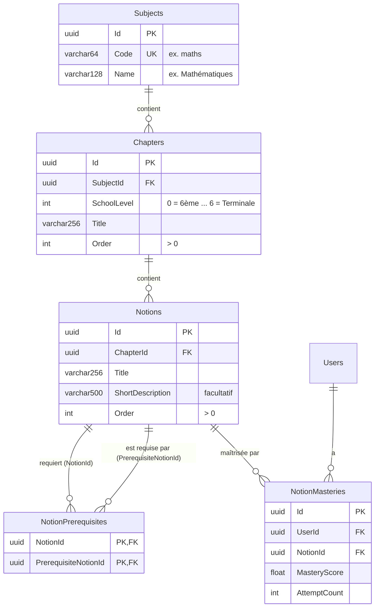

# MonProfAI - Plateforme d'apprentissage pour étudiants

Une plateforme web moderne pour accompagner les étudiants dans leur apprentissage avec une architecture clean et scalable.

## 🎯 Caractéristiques

- ✅ Authentification JWT sécurisée
- ✅ Architecture Clean Architecture (Backend)
- ✅ Frontend React moderne avec TypeScript
- ✅ Base de données PostgreSQL
- ✅ API REST avec ASP.NET Core
- ✅ Docker pour le développement
- ✅ CI/CD prêt (GitHub Actions)

## 🚀 Démarrage rapide

### Prérequis

- **.NET 8.0** - [Télécharger](https://dotnet.microsoft.com/en-us/download)
- **Node.js 20+** - [Télécharger](https://nodejs.org/)
- **Docker & Docker Compose** (optionnel) - [Télécharger](https://www.docker.com/)
- **PostgreSQL 16** (si pas Docker)

### Installation locale

#### 1. Backend

```bash
# Accéder au répertoire du projet
cd C:\Users\GANEMA\RiderProjects\monprofai

# Restaurer les dépendances
dotnet restore src/Backend/MonProfAI.Api/MonProfAI.Api.csproj

# Créer la base de données
# Assurez-vous que PostgreSQL est en cours d'exécution
# Puis exécutez les migrations
dotnet ef database update -p src/Backend/MonProfAI.Infrastructure -s src/Backend/MonProfAI.Api

# Lancer l'API
cd src/Backend/MonProfAI.Api
dotnet run
```

En local, `dotnet run` utilise l'environnement `Development` et se connecte à PostgreSQL sur `localhost:5432` (voir `appsettings.Development.json`).

L'API sera disponible sur `http://localhost:5000`

#### 2. Frontend

```bash
# Accéder au répertoire du frontend
cd src/Frontend

# Installer les dépendances
npm install

# Lancer le serveur de développement
npm run dev
```

L'application sera disponible sur `http://localhost:3000`

### Utilisation avec Docker

```bash
# Démarrer tous les services
docker-compose -f infra/docker/docker-compose.yml up -d

# Les services seront disponibles sur:
# - API: http://localhost:5000
# - Frontend: http://localhost:3000
# - PostgreSQL: localhost:5432

# Arrêter les services
docker-compose -f infra/docker/docker-compose.yml down
```

## 📁 Structure du projet

```
monprofai/
├── src/
│   ├── Backend/                      # API ASP.NET Core
│   │   ├── MonProfAI.Api/           # Point d'entrée de l'API
│   │   ├── MonProfAI.Application/   # Logique métier (CQRS/MediatR)
│   │   ├── MonProfAI.Domain/        # Modèles de domaine
│   │   └── MonProfAI.Infrastructure/ # Accès données, services
│   │
│   └── Frontend/                     # Application React
│       ├── src/
│       │   ├── api/                 # Clients API
│       │   ├── components/          # Composants réutilisables
│       │   ├── pages/               # Pages
│       │   ├── store/               # State management (Zustand)
│       │   └── types/               # Types TypeScript
│       └── index.html
│
├── infra/
│   ├── docker/                       # Configuration Docker
│   └── database/
│       └── migrations/              # Scripts SQL
│
├── .github/
│   └── workflows/                    # CI/CD
│
└── docs/                             # Documentation
```

## 🏗️ Architecture

### Backend - Clean Architecture

```
Domain Layer
    ↓
Application Layer (CQRS/MediatR)
    ↓
Infrastructure Layer (EF Core, JWT, Repositories)
    ↓
API Layer (REST Controllers)
```

**Avantages:**
- Séparation des responsabilités
- Facile à tester
- Scalable et maintenable

### Frontend - React + TypeScript

**Stack:**
- Vite (bundler rapide)
- React Router (navigation)
- Zustand (state management)
- TailwindCSS (styling)
- Axios (HTTP client)

## 🔐 Authentification

### Flux d'authentification

1. **Inscription** - Créer un compte avec email/mot de passe
2. **Login** - Obtenir access token + refresh token
3. **Requêtes authentifiées** - Envoyer token dans header Authorization
4. **Refresh** - Utiliser refresh token pour obtenir nouveau access token

### Tokens JWT

- **Access Token** - Valide 1 heure
- **Refresh Token** - Valide 7 jours

## 🤖 Professeur IA

Le backend appelle un modèle d'IA (aujourd'hui **Claude, d'Anthropic**) pour répondre aux questions des élèves.

### Configurer la clé

1. Copie `.env.example` en `.env` à la racine (le fichier `.env` est ignoré par git).
2. Renseigne `AI_API_KEY=` avec ta clé Anthropic (console.anthropic.com).
3. Relance l'API. Docker Compose transmet la variable au conteneur, et `dotnet run` la lit directement dans `.env`.

La clé reste sur le serveur : elle n'est jamais renvoyée au navigateur. Ne la préfixe surtout pas par `VITE_`, sinon Vite l'intégrerait au code du frontend. Sans clé, l'API démarre quand même et la route répond `503` avec un message clair.

### Interface

Depuis le tableau de bord, **Travailler avec mon prof IA** ouvre `/tutor`. L'élève y choisit une notion, chapitre par chapitre (sa classe est présélectionnée), puis discute avec le tuteur sur `/tutor/:notionId`. Les réponses s'affichent au fur et à mesure, en Markdown, et les formules mathématiques sont rendues avec KaTeX.

### Routes

`GET /api/notions` (authentifiée) : matières → chapitres → notions, triés pour l'affichage.

`POST /api/tutor/ask` (authentifiée), corps : `{ "message": "...", "notionId": "...", "history": [{ "role": "user" | "assistant", "content": "..." }] }`. `notionId` est facultatif : quand il est fourni, le tuteur reste centré sur cette notion.

La réponse arrive en streaming (Server-Sent Events) :

```
data: {"text":"Une fraction "}

data: {"text":"représente un partage..."}

event: done
data: {}
```

| Situation | Réponse |
|-----------|---------|
| Pas connecté | `401` |
| Question vide ou trop longue (> 2000 caractères) | `400` |
| Limite par élève atteinte | `429`, `code: "RateLimited"` |
| Clé absente ou invalide, quota du fournisseur dépassé, fournisseur indisponible | `503` |
| Fournisseur trop lent | `504`, `code: "Timeout"` |
| Réponse illisible ou vide | `502`, `code: "InvalidResponse"` |
| Le modèle refuse de répondre | `422`, `code: "Refused"` |
| Erreur après le début de la réponse | `event: error` dans le flux |

Chaque erreur contient un `message` en français à afficher tel quel à l'élève.

### Réglages (`appsettings.json`, section `Ai`)

| Clé | Défaut | Rôle |
|-----|--------|------|
| `Model` | `claude-opus-5-5` | Modèle utilisé |
| `MaxTokens` | `8000` | Longueur maximale d'une réponse (plafonne aussi son coût) |
| `TimeoutSeconds` | `60` | Délai maximal d'un appel |
| `RateLimit:PermitLimit` / `RateLimit:WindowMinutes` | `30` / `60` | Nombre de questions par élève et par fenêtre de temps |

### Le prompt du tuteur

Les consignes pédagogiques du tuteur sont dans [`TutorSystemPrompt.md`](src/Backend/MonProfAI.Application/UseCases/Tutor/TutorSystemPrompt.md), un fichier à part qu'on peut modifier sans toucher au code (il est intégré à la compilation : relance l'API après une modification). Il décrit :

- la séance : expliquer la notion au niveau de l'élève, puis poser une question courte de vérification ; changer d'approche après une erreur au lieu de répéter ;
- les devoirs : ne jamais faire l'exercice à la place de l'élève, l'aider à démarrer ;
- le ton : bienveillant, encourageant, adapté à l'âge ;
- les limites : refus poli des sujets hors scolaire ou inappropriés pour des mineurs, numéros d'aide (3018, 119, 3114) si l'élève exprime de la détresse.

`TutorPromptBuilder` remplace les balises `{{ELEVE}}` (classe, façon d'apprendre préférée, objectif, matières difficiles) et `{{NOTION}}` (notion, chapitre, maîtrise de l'élève et de chaque prérequis).

Pour vérifier le tuteur après une modification du prompt, avec une clé dans `.env` et le seed chargé :

```bash
dotnet run --project src/Backend/MonProfAI.Api -- tutor-eval
```

La commande joue une séance sur 3 notions du seed (fractions en 4ème, Thalès en 3ème, équations avec un compte sans profil). Un élève simulé répond faux, puis juste, demande qu'on fasse son exercice, puis part hors sujet. Un correcteur IA vérifie chaque réponse du tuteur, et un rapport Markdown est écrit. Elle appelle l'API payante : compter quelques centimes par passage.

### Changer de fournisseur

Tout le code passe par l'interface `IAiChatService` (`MonProfAI.Application`). Pour changer de fournisseur, il suffit d'écrire une autre implémentation à côté de `AnthropicChatService` (`MonProfAI.Infrastructure/Ai`) et de l'ajouter dans `AiSetup` (`MonProfAI.Api/Ai`) sous un nouveau nom de `Provider`.

## 📦 Dépendances principales

### Backend
- `MediatR` - Pattern CQRS
- `FluentValidation` - Validation
- `Entity Framework Core` - ORM
- `JWT Bearer` - Authentification
- `BCrypt` - Hachage de mots de passe

### Frontend
- `React 18` - Framework UI
- `React Router` - Navigation
- `Zustand` - State management
- `TailwindCSS` - Styling
- `Axios` - HTTP client
- `Vite` - Bundler

## 🧪 Tests

```bash
# Tests backend
cd src/Backend
dotnet test

# Tests frontend
cd src/Frontend
npm test
```

## 📊 Base de données

PostgreSQL avec EF Core migrations.

### Schéma principal

- **Users** - Utilisateurs (étudiants, professeurs, admins)
- **Courses** - Cours
- **Lessons** - Leçons/contenus
- **UserCourses** - Inscriptions et progression
- **LearnerProfiles** - Profil apprenant (classe, matières difficiles, objectif, façon d'apprendre)
- **NotionMasteries** - Niveau de maîtrise d'une notion par un élève

### Référentiel des notions

Le programme scolaire est découpé en **matières → chapitres → notions**, avec un graphe de prérequis entre notions. La maîtrise d'un élève (`NotionMasteries`) pointe vers une notion de ce référentiel.



| Table | Rôle | Contraintes principales |
|-------|------|-------------------------|
| `Subjects` | Matière (ex. maths) | `Code` unique |
| `Chapters` | Chapitre d'une matière pour une classe | Unicité (`SubjectId`, `SchoolLevel`, `Order`), `Order > 0` |
| `Notions` | Notion à maîtriser dans un chapitre | Unicité (`ChapterId`, `Order`), `Order > 0` |
| `NotionPrerequisites` | `NotionId` dépend de `PrerequisiteNotionId` | Clé primaire composite, une notion ne peut pas être son propre prérequis |
| `NotionMasteries` | Maîtrise d'une notion par un élève | Unicité (`UserId`, `NotionId`) |

**Règles de suppression** : le référentiel est protégé. On ne peut pas supprimer une matière qui a des chapitres, un chapitre qui a des notions, une notion encore requise par une autre ou une notion déjà travaillée par un élève (`RESTRICT`). Supprimer une notion supprime seulement ses propres liens de prérequis (`CASCADE`).

`SchoolLevel` reprend l'énumération du profil apprenant : 0 = 6ème, 1 = 5ème, 2 = 4ème, 3 = 3ème, 4 = 2nde, 5 = 1ère, 6 = Terminale.

> Les noms de tables suivent la convention EF Core du projet (PascalCase au pluriel) : `subjects` → `Subjects`, `notion_prerequisites` → `NotionPrerequisites`, etc.

### Données de test (seed)

Une commande remplit la base avec des données de test. Elle applique d'abord les migrations, donc elle marche aussi sur une base vide.

```bash
# PostgreSQL doit tourner (docker compose up -d postgres)
dotnet run --project src/Backend/MonProfAI.Api -- seed
```

Si l'API tourne dans Docker (`docker compose up -d`), lance plutôt le seed dans le conteneur :

```bash
docker compose exec backend dotnet MonProfAI.Api.dll seed
```

Le seed contient :

- la matière **Mathématiques** avec les chapitres et notions de **4ème** et **3ème** (programme du cycle 4, réparti selon les repères annuels de progression) et des prérequis entre notions, par exemple *Trigonométrie* → *Théorème de Pythagore* ;
- trois élèves fictifs.

| Email | Mot de passe | Profil |
|-------|--------------|--------|
| `ines.4e@monprofai.test` | `Eleve2026!` | 4ème, questionnaire rempli, en difficulté sur les fractions |
| `hugo.3e@monprofai.test` | `Eleve2026!` | 3ème, prépare le brevet, à l'aise en 4ème et découvre la 3ème |
| `sacha.nouveau@monprofai.test` | `Eleve2026!` | Nouveau compte, questionnaire d'accueil pas encore rempli |

La commande peut être relancée autant de fois que voulu : elle ne crée pas de doublons. Chaque ligne est retrouvée par sa clé naturelle (code de matière, classe et position du chapitre, position de la notion, email…) et mise à jour. Les comptes de test reprennent donc leur état d'origine, et les autres données de la base ne sont pas modifiées.

> Le seed refuse de tourner hors de l'environnement `Development`, car ces comptes ont un mot de passe public.

## 🚢 Déploiement

### Production

1. **Build Docker:**
```bash
docker build -f infra/docker/Dockerfile.api -t monprofai-api:latest .
```

2. **Variables d'environnement requises:**
- `ConnectionStrings__DefaultConnection`
- `JwtSettings__Secret` (changez cette valeur!)
- `ASPNETCORE_ENVIRONMENT`

3. **Déploiement:**
- Heroku, Railway, Azure, AWS, etc.

## 📝 Prochaines étapes

1. [ ] Ajouter les tests unitaires
2. [ ] Implémenter système de cours/leçons
3. [ ] Ajouter système de quiz/évaluations
4. [ ] Intégration avec IA pour recommandations
5. [ ] Dashboard professeur
6. [ ] Système de notifications

## 🤝 Contribution

Créez une branche, faites vos modifications, et créez une pull request.

## 📄 Licence

MIT

## 📧 Support

Pour toute question: cherifganema@gmail.com
